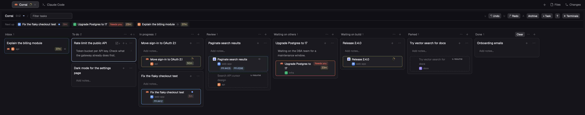

# herdr-corral

My setup for the [Herdr app](https://herdr.dev): a Kanban board where your
tasks hold the coding agents you start for them, packaged as a layout plus
small mods. Each mod works on its own.

- **Corral Board** (`mods/corral-board`): your own columns and tasks; each
  task holds its agents with their Herdr status, a Claude prompt-cache
  countdown and the PR and Jira links they printed; an Inbox of agents not on a task
  yet; drag and drop; launch an agent from a task (optionally in a new git
  worktree) or resume an ended Claude or Codex one, here or on another
  machine; undo, redo and an archive view; keyboard-driven too (`?` on the board).
- **Corral layout** (`layouts/corral.json`): Herdr's main window with the
  board one key (`cmd-shift-k`) or one click away.

Status: `0.1.11`, in daily use. Built on herdr-app 0.1.12. Not yet tried: a
Claude agent on another machine (its cache countdown and resume; Codex there
works).

## Use the whole setup

Ask your agent in Herdr: "add the layout from github.com/martinkozle/herdr-corral".
It copies `layouts/corral.json` and `mods/corral-board`, merges `keys.json`
into yours, and switches to the `corral` layout. `ctrl-shift-l` switches
back.

## Take a piece

Each folder under `mods/` stands alone with its own `RECIPE.md`:

- `corral-board`: in any layout, `cmd-shift-k` (`mod.open:corral-board`)
  opens it as a window.

If the files don't work on your Herdr version, have your agent rebuild from the
`RECIPE.md`. The recipes are the source of truth; the code is one build of them.

## What it touches

The board runs `herdr-app` and `hc` (to start agents, label their
terminals and read their screens for PR and Jira links), `git` (only for a new
worktree), `open`/`xdg-open` (a link you click), and `find`, `tail`, `ls`,
`rm`, `mkdir`, `ps`, `wc`, `grep`, `printenv` (here and on machines with
agents on the board). It reads Codex's `~/.codex/sessions/` too. It reads Claude Code's
`~/.claude/sessions/` and `~/.claude/projects/` (for the cache countdown and
resume) and keeps its data in `~/.config/herdr-app/corral/` (`board.json`
plus its last 50 versions in `backups/`). No network.

Undo (`u`) and redo (`U`) cover the board window's own changes since it opened. For
anything older, restore a file from `corral/backups/` over `board.json` (or
ask your agent to); the board reloads by itself.

## Developing

Herdr's hot reload doesn't follow a symlinked mod folder, so edit here and run
`scripts/dev-sync.sh`: it copies `mods/*` into `~/.config/herdr-app/mods/` and
runs `herdr-app check`. Bump `BUILD` in `main.js` on every change; the board's
header shows which build is running. Render errors only show in the window, so
look at it (`herdr-app shot`).

## Later

- Space tiles in the launch form.
- Focus: the picked agent's terminal beside the board (left or right, your
  choice), to answer it without flipping away. Optional.
- PR chips colored by state (open, merged) where `gh` can tell.
- The question a "needs you" agent asks, read off its screen.
- `corral-agents`: Herdr's agents list plus a cache-warmth sort and task
  names. Experimental, may never ship.
- Resume for OpenCode; a cache countdown for Codex and OpenCode, if they ever
  state their cache lifetime.
