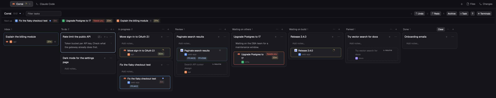

# Corral

Herdr's main window with a Kanban board one key away: the spaces and agents
sidebar stays on the left, and the work area flips between your terminals and
the Corral Board, where your tasks hold their agents.

Built on herdr-app 0.1.12 (a clone of `main` from 0.1.11).

## What you see

Herdr (main), unchanged, plus:

- A **Board button** at the top bar's right end, beside Files and Changes
  and drawn like them (26px, 12px text, `muted` on `chrome`, `hover` on
  hover): a layers icon and "Board" with the Inbox count in `dim`, or
  "Terminals" on `selected` while the board shows.
- The work area (left of the Files / Changes panel) is a stack of two views:
  the active tab, as in main, and the Corral Board
  (`mods/corral-board/RECIPE.md`).

## How it behaves

- The Board button, or `cmd-shift-k`, flips between terminals and board. The board
  takes the keyboard when it shows; the focused terminal pane gets it back
  when it hides.
- Going to an agent from the board (click, `1`–`9`, launch, resume) flips back
  and focuses that agent.
- Everything else is Herdr (main).

## Built from

- `layouts/corral.json`: `layout.clone {name: "main", as: "corral"}`, then
  the `main` block (inside `work-body`) wrapped in a `stack` `corral-view`
  (`active: "main"`): child `main` (the tab block, unchanged) and child
  `board` (`{ "mod": "corral-board" }`). The `tabs` block (42px) becomes a
  `row` `top` (42px, `resizable: false`): `tabs` (weight 1, `window_drag`)
  and `corral-toggle` (112px, `window_drag`, `{ "mod": "corral-board",
  "props": { "role": "pill" } }`).
- `keys.json`: `"layout:corral": { "cmd-shift-k": "corral-board.toggle" }`
  (reaches the Board button's copy of the mod: Herdr sends `<mod>.<command>`
  only to copies on screen, and the board copy is hidden while terminals show) and `"global": { "cmd-shift-k":
  "mod.open:corral-board" }` (the board as a window in other layouts).
- Mods: `corral-board`, plus Herdr's own `workspace-chrome`, `spaces`,
  `agents`, `tabs`, `pane`, `files`, `changes`, `workspace-status`.

## Watch out

- The clone stops following updates to Herdr's `main`; when a new Herdr
  changes `main`, clone it again and redo the two edits above.
- `cmd-shift-k` is macOS; on Linux and Windows use `ctrl-shift-k`.
- A mod reload (or switching layouts) shows the terminals again.

## Done when

- `layout.switch {name: "corral"}` shows main plus the Board button; the button flips to
  the board and back; `cmd-shift-k` does the same, keyboard included.
- In the `main` layout, `cmd-shift-k` opens the board as a window and closes
  it.
