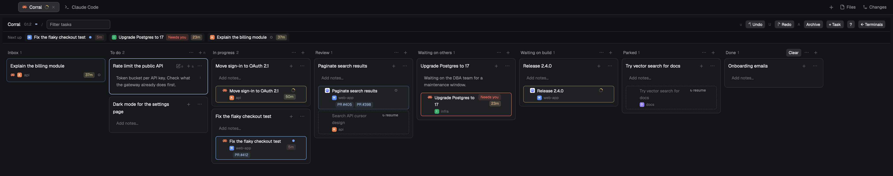

# Corral Board

A Kanban board for your own tasks, each holding the coding agents you started
for it. You move tasks through your columns by dragging; each agent's Herdr
status and its Claude prompt-cache countdown show on the card, so you can see
at a glance which agent to answer before its cache goes cold. Agents you start
anywhere in Herdr wait in an Inbox until you give them a task.



Built and used on herdr-app 0.1.12 / hc 0.1.17 (build `0.1.4`).

## What you see

One full-size view on `canvas`, top to bottom:

- **Header** (40px, `chrome`, bottom `border`): "Corral" (13px semibold), the
  build (`0.1.4`, 10.5px `dim`), a ⌨ mark (`accent` while the board has the
  keyboard, faint `dim` when a click is needed first), a faint `/` hint, the
  filter field (180px, "Filter tasks"), then on the right "+ Task", "?" (lit
  while the key help shows), and "← Terminals" (corral layout) or "Close"
  (window).
- **Next up** (34px, `chrome`, bottom `border`), only while some Claude agent
  waits for you (idle, done or blocked) with a warm cache: "Next up" (11px
  `dim`), then one chip per such agent, soonest expiry first: space tile, the
  task's name (else the agent's), status, cache badge. A click goes to the
  agent.
- **Columns**, 280px wide, 10px apart, starting 10px in. Each scrolls
  vertically on its own; the row of columns scrolls sideways.
  - **Column header** (32px): name (12px medium `muted`), task count (11px
    `dim`), then "⋯" (column menu) and "+" (new task). The Done column also
    has "Clear" while it holds tasks.
  - **Inbox** is always first: no menu, no "+", can't be moved or deleted.
- **Default columns:** To do · In progress · Review · Waiting on others ·
  Waiting on build · Parked · Done.
- **Task card** (`surface`, 1px `border`, radius 8, 10px padding, 6px apart;
  `accent` border when selected):
  - Title (13px medium, wraps), then on the right: pencil (rename), "+"
    (launch an agent), "⋯" (Archive, Delete).
  - Notes: a faint box under the title (`background` at 50%), "Add notes…"
    when empty, the text in `muted` otherwise. Always shown.
  - Agent rows, live ones first, then ended ones. Each row is its own block
    (6px radius, `foreground` at 4% for live rows, untinted for ended), 4px
    apart:
    - left: its number (1–9, a faint hint), the program icon (14px);
    - middle: the agent's name (12px, wraps in full), and under it the
      space's tile (13px square, its first letter on its color) and name
      (10.5px `dim`);
    - right, stacked: the status, and under it the cache badge; then "×".
  - **Ended** rows: name in `dim`, "ended" on the right. An ended Claude or
    Codex agent whose session is known instead shows "↻ resume" and a dashed
    `input` border.
- **Inbox card**: a dashed-looking card (`background`, `input` border) with
  the agent's name, its icon, space tile and name, cache badge and status.
- **Status** (as in Herdr's agents list): working = a 12px ring spinning in
  `working`; blocked = a "Needs you" pill (`blocked` on 15% `blocked`) with
  Claude's reason as a tooltip ("input needed"); done = a 7px `done` dot; idle
  = a 7px `idle` ring.
- **Cache badge** (Claude agents only): minutes left ("47m", "<1m") on a pill
  whose color follows the share of the cache's own lifetime left: full =
  `ansi2`, half = `ansi3`, none = `ansi1` (pill at 20%, text full). Expired:
  "cold" in `dim`, no pill. Unknown: nothing.
- **Key hints:** faint letters inside their buttons (pencil `e`, "+" `a`,
  column "+" `n`, notes `i`, agent numbers). They show on a hovered or
  selected card, and on the selected column; hidden ones keep their space.
- **Bottom bar** (36px, `chrome`), only when needed: a confirmation ("Delete
  …?" Yes (y) / No (n), "Don't ask again" on Move to Done), the "Move to:"
  list, the key help, or a note ("Move its tasks first.").

## How it behaves

- **Tasks and agents are separate.** A task's column changes only when you
  move it. Agent status is Herdr's; nothing an agent does moves its task.
- **Inbox:** every Herdr agent in no task. Not stored: an entry disappears
  when its agent ends. Sub-agents never appear. Clicking an entry goes to the
  agent; renaming it (`e`) or dragging it to a column makes it a task.
- **Drag** (press, move 4px): a ghost card follows the pointer, the lifted
  card fades to 35%, and an `accent` line shows where it lands.
  - A task → a column: placed at the line.
  - An Inbox entry → a column: a new task holding that agent.
  - An Inbox entry or an agent row → the middle of a task card (the card
    lights up): the agent joins that task (leaving its old one).
  - An agent row → a column's empty space: a new task with it.
  - An agent row → the Inbox: it leaves its task.
  - A release never also counts as a click.
- **Click** a card: select it. **Double-click** a title: rename. **Click** the
  notes: edit them in place, with Cancel and "Save ↵" and a "⇧↵ new line"
  hint; Enter saves, Shift+Enter is a new line, clicking away saves, Esc
  closes unchanged notes and asks "Discard your changes to the note?"
  otherwise. **Click** an agent row: go to it. **Click** a "↻ resume" row:
  resume it.
- **Launch** ("+" or `a`): the card opens a form with a space and an agent
  dropdown (the task's last space; your first installed agent; or "Custom
  command…", a command field remembered for next time), and a first-message
  box (focused; "Use notes" copies the notes in). Enter or "Launch ↵" starts
  a tab named after the task ("<title> 2", "3"… for later agents) in that
  space, sends the message if there is one, adds the agent to the task, and
  goes to it.
  - Keys: the message box has the keyboard; `esc` leaves it, then `s` / `p`
    open the space / agent picker (`j` `k`, `enter` picks, `esc` closes it),
    `w` toggles a new worktree, `i` goes back to the message,
    `enter` launches, `esc` closes the form. One control per row (space and agent, each under a small label; message;
    worktree), each with its faint key hint in one gutter on the left (hidden while typing). No separate key line: `esc` and the Launch ↵ button cover the rest.
  - **New worktree** (☐ checkbox, `w`): a branch field (Enter launches). The
    agent starts in a git worktree where Herdr's worktree mod keeps them,
    `~/.herdr/worktrees/<repo>/<branch, slashes as dashes>` (so that mod's
    open and remove find it), made from the space's folder (its first
    terminal's folder, else where it was made): an existing branch is checked
    out, a new one starts at that folder's HEAD; a checkout already at that
    path is reused. The tab stays in the chosen space. On another machine,
    git runs there.
- **Resume:** `claude --resume <session>` (Codex: `codex resume <session>`)
  in a new tab in the agent's old folder, on the machine it ran on (its old space, else a space on that
  machine; none open: a note says so); the row then follows the new agent.
- **"×" on an agent row** (or `d`/`x` while it's picked): the agent leaves the
  task and goes back to the Inbox. Its terminal keeps running.
- **Column menu (⋯):** Rename, Move left, Move right, Add column before, Add
  column after, Delete column. Deleting a column that holds tasks is refused.
- **Archive** (`x`, or ⋯): the task leaves the board into the file's archive.
  **Delete** (`d`, or ⋯) asks first, then also moves it there, marked
  `deleted` (dropped after 30 days). **Clear** archives everything in Done.
- **Archive view** ("Archive" in the header, or `A`): replaces the columns
  with a 640px list of archived and deleted tasks, newest first (title; when,
  from which column, agents, the notes' first line), through the filter.
  `j` `k` select, `r`/`enter` or "Restore" puts one back at the end of its
  column (the first column if that's gone), `esc` closes. Its agents' labels
  were never cleared, so live ones rejoin it.
- **Waiting time:** a live agent that isn't working shows how long it has
  waited, as plain words after its space (never a pill, so it isn't read as
  the cache badge): "· waiting 6m" (needs you, in the blocked color, or done
  and not looked at, `dim`). Idle agents show none: it comes from the
  terminal's `status_ms`, the last change of the agent's own status, and
  looking at a done agent (done → idle, an app-side "seen") doesn't move it,
  so "idle 3h" would mean "finished 3h ago". Inbox cards show it after the
  space name.
- **Space chips:** under the header (and Next up), a row: `s` hint, "All n",
  then one chip per space with something on the board (sidebar order): its
  tile, name, count of tasks and Inbox agents, and a blocked-color dot when
  an agent there waits for you. A click filters the board to that space (a
  task counts for its own space and each of its agents'), again clears;
  `s` / `S` step through the chips, `esc` clears. Shown with 2+ spaces.
  Chips and counts come from the unfiltered board and Inbox, so filtering
  never hides a chip.
- **Status outlines:** a live agent row (and an Inbox card) waiting on you
  is outlined: done (finished, not looked at yet) in the done color, needs
  you in the blocked color, idle (finished and seen) in a faint done color.
  Working agents get an outline in the working (spinner) color that slowly
  breathes between part and full strength (a full outline fading in and out
  over a part-colored border) (`loop("opacity")`, native). A line travelling round the
  border isn't possible: Herdr animates only opacity, size and position, and
  spins only SVGs.
- **A cache badge nearly out** (under a fifth of its time left: about 12
  minutes of a 1h cache, 1 of a 5m one) breathes the same way, a little faster.
- **Undo** ("↶ Undo" in the header, or `u`): puts back the board as it was
  before this window's last change, up to 50 steps (in memory: since the
  window opened). The board's own saves (agents rejoining, sessions and PR
  links recorded) aren't steps: they are replayed onto the undo history so
  undo keeps them. If the file changed elsewhere since, undo stops and says
  so (backups remain). Terminal labels follow the undo. **Redo** ("↷ Redo",
  `U` or `ctrl-r`) puts an undone step back, under the same rule; a new
  change drops what's left to redo. After either, the board has the keyboard
  and a task the step moved (or brought back) is selected.
- **PR links:** the last three pull/merge request links each agent printed
  (GitHub, GitLab, Bitbucket Cloud and Server/Data Center) show under its
  name as chips ("PR #12", "MR !7"), newest first; a click (or `o` while the
  row is picked) opens it in the browser. They stay on the row after the
  agent ends. The chips wrap from one left edge (under the space tile), and
  the faint `o` hint follows the last chip, so a second line of chips starts
  where the first did.
- **Filter:** shows tasks whose title, notes or agent names contain the text,
  and Inbox entries whose name does.
- **Keys** (only while the board has the keyboard; text fields take every key):

  | Key | Action |
  |---|---|
  | `h` `l` / ← → | previous / next column |
  | `j` `k` / ↓ ↑ | next / previous card |
  | `g` `G` | first / last card |
  | `H` `L` / shift-← → | move the card to the previous / next column; it stays selected, so repeat to carry it further. On an Inbox agent, `L` makes it a task in the first column (as dropping it there does) |
  | `K` `J` / shift-↑ ↓ | move the card up / down |
  | `m` | "Move to:", then 1–9 picks a column (an Inbox agent becomes a task there) |
  | `space` | move the card to Done (asks, with "Don't ask again") |
  | `n` | new task in this column (a draft card: Enter adds, Esc cancels) |
  | `e` | rename the card (an Inbox entry: make it a task) |
  | `i` | edit the card's notes |
  | `a` | launch an agent from the card |
  | `enter` | pick one of the card's agents: `j` `k` move, `enter` goes to it or resumes it, `o` opens its newest PR link, `a` opens the launch form, `d`/`x` take it off the task, anything else leaves (only `h` `l` carry on) |
  | `t` | on an Inbox agent: add it to an existing task. Move to the task with the usual keys; `enter` adds it, `esc` cancels (the bottom bar says so) |
  | `1`–`9` | go to (or resume) the card's Nth agent |
  | `x` | archive the card |
  | `d` | delete the card (asks) |
  | `X` | archive everything in Done (asks) |
  | `u` | undo |
  | `U` / `ctrl-r` | redo |
  | `A` | the Archive view |
  | `s` / `S` | filter by space: next / previous chip (through All) |
  | `/` | filter; `esc` clears it |
  | `?` | key help (again: closes) |

- **Opening the board.** In the corral layout: the Board button in the top bar, or
  `cmd-shift-k`, flips the work area between terminals and board; the board
  takes the keyboard when it shows, the terminal pane gets it back when it
  hides. Elsewhere: `cmd-shift-k` opens the board as a window (90%×85%) and
  closes it again.
- **Live.** The board redraws on Herdr's data changes, reloads when
  `board.json` changes on disk, re-reads a Claude transcript when it changes,
  and checks everything every 30s (the countdown, session ids, rejoining
  agents). Nothing animates on a timer.

## Built from

- **Folder** `mods/corral-board/`: `main.js` (the view), `store.js` (load,
  migrate, save, backups), `cache.js` (Claude cache), `codex.js` (Codex sessions), `mod.json` `{ "place":
  "none", "title": "Corral Board", "focusable": true, "overlay": { "kind":
  "window", "width": 0.9, "height": 0.85 } }`, `jsconfig.json` (`checkJs`).
  Plain JavaScript, no npm packages, no bundler.
- **Props:** none → the board; `{ role: "pill" }` → the corral layout's
  Board button in the top bar ("Board", or "Terminals" while the board
  shows; a blocked-color badge counting agents that need you or are done
  and unseen; the Inbox count in `dim`), which also receives `corral-board.toggle`: it is always
  on screen, and Herdr delivers a mod's commands only to copies on screen.
- **State:** `~/.config/herdr-app/corral/board.json`, read with
  `readTextFile`, written with `writeTextFile(path, text, expected)` (refused
  when stale: reload, re-apply, retry up to 3 times), watched with
  `watchFolder`. Before each save the replaced version goes to
  `corral/backups/board-<UTC time>.json`; the newest 50 are kept. Not inside
  the mod folder: a write there would reload the mod.

  ```json
  { "schema": 1,
    "columns": [ { "id": "todo", "name": "To do" } ],
    "tasks": [ {
      "id": "t-mvzb7etqk4u0", "title": "Fix login", "notes": "", "column": "todo",
      "space": "spfa98…", "created": 1793614046059, "updated": 1793614046059,
      "agents": [ { "address": "t7", "app": "claude-code", "name": "Fix login",
                    "space": "spfa98…", "started": 1793614046059,
                    "session": "531369f2-…", "cwd": "/Users/me/dev/app" } ] } ],
    "archive": [],
    "prefs": { "confirmDone": true, "customCommand": "pi --model x" } }
  ```

  Order within a column is order in `tasks`. Ids are never reused. `session`
  and `cwd` are set only for Claude agents whose conversation is on disk. On
  load, a lower `schema` runs each migration in turn; a higher one shows the
  board read-only with a banner and never writes.
- **Binding:** the task lists the agent's address, and the terminal carries
  `corral.task=<task id>` (`hc label <t> corral.task=<id>`; `corral.task=`
  removes it). Every 30s, live terminals that carry the label and run an agent
  (`report.app`) rejoin their task if it lost them. A listed address counts as
  that agent only while its terminal still carries the task's label and runs
  an agent; otherwise the row is "ended".
- **Launch / resume:** `exec("herdr-app", ["do", "tab.new", JSON.stringify({
  space, name, argv, task?, folder? })])` → `{ space, tab, terminal }`, then
  the label, then `pane.focus {terminal}`. Custom commands are split on
  spaces, quotes kept together; no shell syntax.
- **Cache** (`cache.js`, Claude only, this machine and other machines whose
  `machines()` layout is `ready`; entries keyed by machine and pid):
  `terminals()[i].foreground.pid` → `~/.claude/sessions/<pid>.json` (`sessionId`, `cwd`,
  `status`, `waitingFor`) → `exec("find", …)` once for
  `~/.claude/projects/*/<sessionId>.jsonl` → `exec("tail", ["-c", "2000000",
  path])`. TTL = 1h if the last `api-request` line with `querySource ===
  "repl_main_thread"` has a `cacheControl[].value.ttl` of `"1h"`, else 5m (the
  last known one if none is in the tail). Expiry = last `assistant`
  `timestamp` + TTL. `watchFolder` on each transcript's folder re-reads it.
  On another machine (`m/t4`): its home from `exec("printenv", ["HOME"],
  {on})`, the session file by `readTextFile(path, {on})`, `find` with `{on}`,
  and no watcher (local only): every 30s tick runs one `sh -c` there that
  exits 3 when the transcript's size is unchanged, else prints the size and
  the tail's `assistant`/`api-request` lines.
- **Codex sessions** (`codex.js`, for resume; no cache badge): Codex records
  no process → session link (its TUI writes through a shared `codex
  app-server` daemon and logs without a thread id), so it is matched: every
  30s, one `bash -c` per machine with live Codex agents prints each process's
  `ps -o etime=` and the first line (`session_meta`: `id`, `timestamp`, `cwd`,
  `thread_source`) of every `~/.codex/sessions/**/rollout-*.jsonl` changed
  since the oldest started. Each agent takes the newest unclaimed user
  session in its folder started at most 10s before its process, newest
  process first; none: the id after `codex resume` in its argv.
- **Space tiles:** the first letter of the space's name on the color the
  shipped `spaces` mod assigned (shared `"space.colors"`: id → `ansiN`), from
  a copy of its table: `ansi6 #22a99a`, `ansi3 #e3814f`, `ansi4 #5b8def`,
  `ansi5 #8b7cf6`, `ansi2 #3fae6a`, `ansi1 #d9649a` (default `ansi6`).
- **Herdr data:** `agents()`, `terminals()`, `spaces()`, `machines()`,
  `knownAgents()`, `theme()`, `layout()`, `focused()`, `shared()`.
  **Commands:** `layout.select`, `pane.focus`. **Programs:** `herdr-app`,
  `hc`, `find`, `tail`, `ls`, `rm`, `mkdir`. No network.

## Demo mode

For screenshots (`preview.png`) without your own tasks. With
`<appHome>/corral/demo.json` present when the board starts, it shows that
file instead: `{ board, spaces: [{ id, name, color }], agents: [{ address,
task?, title, app, space, status, cache?: { min, ttl } }] }`. Agents with a
`task` sit in it as live rows, the others in the Inbox; cache badges count
down from `min`. Program icons are borrowed from a running agent of the
same app. Nothing is saved, labelled or polled, and the real `board.json`
isn't read. `scripts/demo-board.json` is the one used for the preview: copy
it to `corral/demo.json`, reload the mod, screenshot, delete the file,
reload again.

## Watch out

- `node --check main.js` passed a file missing a `)` that Herdr's parser
  rejected ("Unexpected token ';'", at a column past the line's end). Run
  `herdr-app check` (dev-sync does) and trust it, not node.
- PR links: Claude's come from its transcript tail (so also links it only
  read, e.g. a `gh pr list`); other agents' from their screen at each 30s
  tick (`hc read --json`; Claude's screen has no scrollback): a link that
  scrolls away between ticks, or wraps across lines, is missed.
- A first message that's filled in but not sent isn't possible: `hc send`
  and `tab.new {task}` always press Enter, `hc keys` presses named keys only,
  `terminal.paste` uses the clipboard, and `claude`/`codex` take a prompt
  only to send it.

- **Hot reload doesn't follow a symlinked mod folder.** Copy the folder into
  `mods/` (this repo: `scripts/dev-sync.sh`), and bump `BUILD` in `main.js` on
  every change: the header shows which build is running.
- **`herdr-app check` and `herdr-app status` miss render errors** in parts
  the first render doesn't reach (agent rows, cards). The window shows "This
  view could not be re-rendered" instead. Look at the running board
  (`herdr-app shot`) after each change.
- **Tasks spawned from `render` never run**, silently. Focus can't move from
  `render` either. The board starts one long-lived task in `init` and wakes
  it from `render` to take the keyboard.
- **A hidden stack child doesn't render.** A request made while it's hidden
  (the flip's focus request) must be repeated after it shows: the Board button
  asks again 120ms after flipping.
- **`pane.focus` then `focused()`:** `focused()` hasn't caught up yet; refocusing
  "the focused pane" right after a `pane.focus` undoes it.
- **A text box that disappears while it has the keyboard sends no `blur`**
  (its card closed, the branch field hidden, an undo). Counting focus/blur
  events got stuck "typing" and swallowed every board key. The board now keeps
  the set of focused boxes, drops it whenever its own handle `is_focused()`,
  and hands the keyboard back when a focused box is no longer drawn.
- **Herdr's Tab moves focus through the whole window** (the filter box, then
  out of the board, where its keys no longer arrive) before the board's own
  key handler can stop it, and `tab_stop(false)` is not wired on `Input`
  (check warns). So the board doesn't use Tab; `i` and `esc` move in and out
  of the message box.
- **Columns stretch** (`items_stretch` on the row) rather than `h_full()`,
  which sized them to the row's full height plus its padding and left a
  little scroll at every column's end.
- **`cx.bind_keys` bindings are app-wide and outlive the mod** (until Herdr
  restarts); a removed one fails as an unknown command. Don't use them.
- **A textarea's `submit` fires on every Enter**, with `shift` / `secondary`
  flags; on Shift+Enter it also inserts the line break itself. `cmd-enter` is
  taken by the textarea on macOS.
- **Theme colors may carry alpha** (`#ffffff18`): cut to `#rrggbb` before
  adding one. `flex_shrink` needs its number.
- **Element events:** a press on a text field must stop propagation, or the
  board's own press handler takes the keyboard back. A drag's release also
  fires `on_click` on what's under it.
- **The textarea's cursor** starts at 0; `set_selected_range` after `focus()`
  puts it at the end.
- `tab.new` runs the agent in your shell, which stays when the agent exits:
  "ended" means no agent runs there, not that the terminal finished. Claude
  writes `sessions/<pid>.json` at start but the transcript only with the first
  message; `claude --resume` refuses a session without one.
- An unavailable machine makes its agents "away", never "ended".
- The space tile colors are a copy of the `spaces` mod's table; a Herdr that
  changes them needs the copy updated.
- The cache color is relative to each cache's own lifetime; read the minutes
  to compare agents. Codex and OpenCode agents get no cache badge. Remote
  badges lag up to 30s behind a reply (polled, not watched).
- Remote Claude cache and resume were built without a Claude agent ever
  running on another machine (2026-11-03: only Codex on `martinkozle`).
  The pid part holds: `hc get m/t1` gives that machine's own pid as
  `foreground.pid` (checked with `ps` there), and mods' `terminals()` carry it
  for remote terminals (Codex resume on `martinkozle` relies on it and works).
  `hc ls --json` leaves `foreground` out for every terminal.
- The Codex session match is a guess from folder and start time: two Codex
  agents started in one folder within ~10s can swap sessions. Herdr's own
  Codex hook reports the exact id, but only to the app, and mods can't read it
  (and it doesn't run on remote machines: no `HERDR_PANE_ID` there).
- `board.json` must stay under 1 MiB (`readTextFile`); the archive is what
  grows.

## Done when

- `herdr-app check mods/corral-board` passes and the header shows the build.
- A new board shows Inbox plus the seven default columns; running agents are
  in the Inbox.
- Column "+" shows a draft card: Enter adds the task, Esc adds nothing; the
  task survives a Herdr restart.
- A task dragged to the fourth spot of another column lands there; dragging an
  Inbox entry onto a task adds the agent (`hc get <t>` shows `corral.task`);
  dragging an agent row back to the Inbox removes it and its label.
- Launch opens a named tab in the chosen space with the agent running, its row
  on the card, and Herdr showing it.
- A Claude agent's badge matches its transcript's last reply + TTL, and turns
  "cold" after; once it exits, its row offers "↻ resume", which reopens the
  conversation.
- In the corral layout `cmd-shift-k` flips to the board and `j` works at once;
  flipping back lets you type in the terminal at once.
- Enter saves notes; Shift+Enter adds one line break; Esc on changed notes
  asks first.
- Deleting a non-empty column is refused; Clear empties Done into `archive`.
- Every save adds a file to `corral/backups/`; never more than 50.
- Editing `board.json` by hand shows on the board without a restart; a
  `schema: 99` board opens read-only and is never written.
